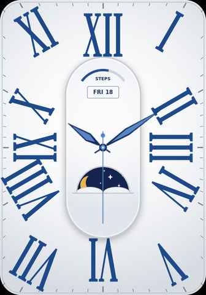
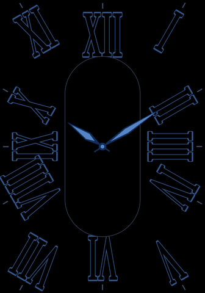

# Phantom Blue: a watch face for HUAWEI WATCH FIT 2

This is a recreation of a "Phantom Blue" style analog face. It has a silver sunray dial, large blue Roman numerals that point toward the centre, a centre capsule with a steps arc and a date window, a moon window and slim blue leaf-shaped hands.

All the art is drawn in code by `generate.py` at the Watch Fit 2 screen size, **336 × 480 px**.

| Normal | Always-On Display |
|---|---|
|  |  |

## Build the assets

```bash
pip install pillow
python3 generate.py      # writes everything to ./output
```

Colours, sizes and the font are constants at the top of `generate.py`.

## What's in `output/`

| File | Use in Theme Studio |
|---|---|
| `background.png` | Background layer (336×480). Numerals, ticks, capsule, steps track, date frame and moon window are already in it |
| `aod_background.png` | AOD background (black, outlined numerals, low pixel count) |
| `hand_hour.png`, `hand_minute.png`, `hand_second.png` | Pointer layers. Pivot coordinates are in `layout.json` |
| `steps_progress.png` | Arc image for a steps **progress / arc** widget |
| `digits/0-9.png`, `weekdays/MON-SUN.png` | Image sets for the date window, if you want image-based text instead of a system font |
| `layout.json` | Exact positions: hand pivots, date box, steps arc angles |
| `preview.png`, `preview_aod.png` | Composited previews at 10:09:30 (don't import these) |

### Hand pivots (from `layout.json`)

| Hand | Image size | Pivot inside image | Place image top-left at |
|---|---|---|---|
| Hour | 22×92 | (11, 74) | (157, 166) |
| Minute | 20×136 | (10, 116) | (158, 124) |
| Second | 18×158 | (9, 128) | (159, 112) |

The dial centre is **(168, 240)**.

## Turning it into an installable face (.hwt)

Huawei watches only install signed `.hwt` packages. You can't make one by hand. You build it with Huawei's free **Theme Studio** (Watch Face Maker):

1. Register as a theme designer at <https://developer.huawei.com/consumer/en/huawei-theme> and download **Theme Studio**.
2. Create a new watch face project and choose **HUAWEI WATCH FIT 2** (336×480).
3. **Background:** import `output/background.png`.
4. **Pointers:** add hour, minute and second pointers. Import each `hand_*.png` and set its rotation centre to the pivot in the table above, at dial centre (168, 240).
5. **Date:** add a *week* and a *day* text element inside the date box at (142, 140) to (194, 160). Use the colour `#122E5C` and a size of about 9 px. You can also use the `weekdays/` and `digits/` image sets.
6. **Steps (optional):** add a steps progress/arc widget with `steps_progress.png`. The arc is centred at (168, 156) with a radius of 44 and runs from −55° to +55°, measured clockwise from 12 o'clock.
7. **AOD:** in the AOD tab, import `aod_background.png` and reuse the hour and minute hands.
8. Use **Preview**, then **Test on device** to sideload the face onto your watch through the Health app. You'll need to register your device for testing in Theme Studio. When it's ready, export the `.hwt`.

> Huawei changes Theme Studio's menu names and its device-testing process from time to time. If a step above doesn't match what you see, follow the current Theme Studio documentation.

## Note

This is a fan recreation for personal use. The original "M.Phantom Blue" face belongs to its designer. Don't publish this one to the Huawei Watch Face Store as their design.
